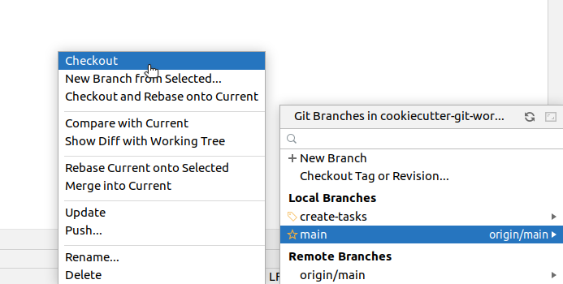
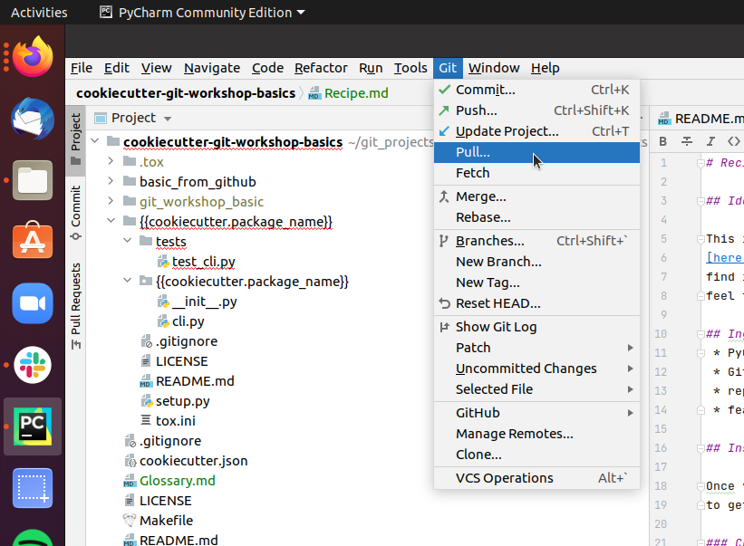
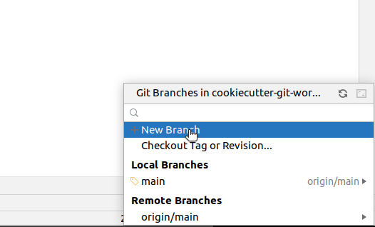
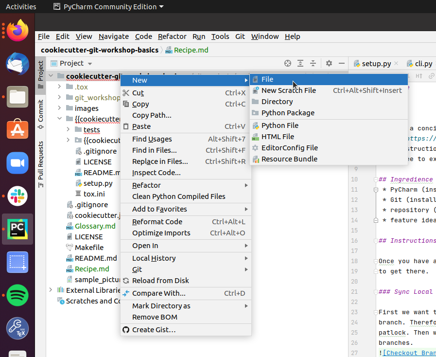
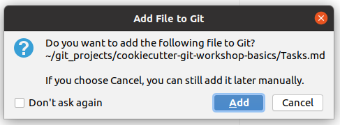
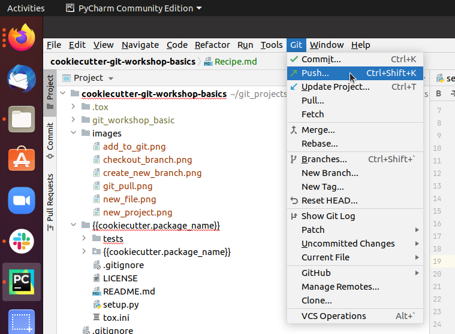

.. _git-workflow:

============
Git Workflow
============

.. note::

   Some screenshots in this guide are placeholders pending a refresh of the
   2021-era GitLab UI captures. Where a screenshot is missing, a short prose
   description of what you should see/do is given instead.

Idea
====

This is a concise manual to a basic Git workflow. You can find more details
`here <https://guides.github.com/introduction/flow/>`_. For each step you can
find instructions how to follow that workflow using PyCharm. There is different
ways to achieve the same goal without PyCharm. Once you are familiar with the
basic concepts you can use any tool you like.

Instructions
============

Once you have an idea what you want to achieve the following steps will help you
to get there.

.. contents:: Steps
    :local:

Update Local
____________

First we want to make sure to use the newest version of the repository's main
branch. Therefore we click on the button in the bottom right corner next to the
padlock. Then we see a context menu like this that displays all the local
branches.

Click on the main branch and choose "Checkout" in the second context
menu to switch to the main branch.
Now we need to make sure that your local main branch is up to date with
the upstream main branch. Therefore we pull the newest state from upstream. In
the upper left corner we can find the menu bar, click on "Git" and choose pull
in the pull down menu.

Create Branch
_____________

Now we create a branch to implement our feature. In order to do so move your
cursor to the bottom right corner and click on your current branch name,
which should be main, next to the padlock.

Within the context menu click on "New Branch" and enter a branch name that
relates to your feature idea.

Add Commits
___________

Now you need to add, change or delete some content in the repository to achieve
your goal. For instance you want to add a new file "Tasks.md". Then you make a
right click onto the folder that should contain your new file.

In the context menu select "new" and "File" and enter the filename in the
consecutive prompt. Then PyCharm wants to know if Git should look after your
new file.

Normally that is a good idea and you shall choose "Add".

Push Branch
___________

Now you want to push the branch with your changes to the upstream server. This
way you create an identical copy of your local branch on the server. To do so

go to the upper left corner where you can find the menu bar and click on
``Git`` and choose ``push`` in the pull down menu.

Merge Request
_____________

Now that you pushed your local branch to the upstream server, you want to
create a merge request on the server. Therefore open your browser and go to
``https://git.tu-berlin.de/your_name/your_project/``. On the left hand side
you click on ``Merge Requests``. This takes you to an overview page listing
all open (and past) merge requests for the project, with a prominent
``Create merge request`` button in the top right corner.

.. note::

   Screenshot placeholder - see the note at the top of this page.

Click ``Create merge request`` to create a request to merge ``your_branch``
(here: "basic_description") into ``main``. On the following page you get a
form where you can add a title, a longer description of what you changed and
why, and assign a reviewer (a colleague or, in the workshop, yourself).

.. note::

   Screenshot placeholder - see the note at the top of this page.

Fill in the description and assign a reviewer, then submit your merge
request.

Discussion
__________

Now the reviewer of the merge request checks your changes and gives you
feedback. After some discussion you might want to go back to step 3 and add
additional commits to change the current state. For the sake of practising
some interations in the workshop, you can just approve your own merge requests
and continue.

Merge Branch
____________

When all discussions are done and you are sure that your changes improve the
main branch, it is time to merge your branch. On the merge request page, once
the merge request is approved, a green ``Merge`` button becomes available
near the top of the page.

.. note::

   Screenshot placeholder - see the note at the top of this page.

Click ``Merge`` to merge your branch into ``main``.

Now ``main`` on the upstream server is newer than your local branch and its
time to start all over again (`Update Local`_).
