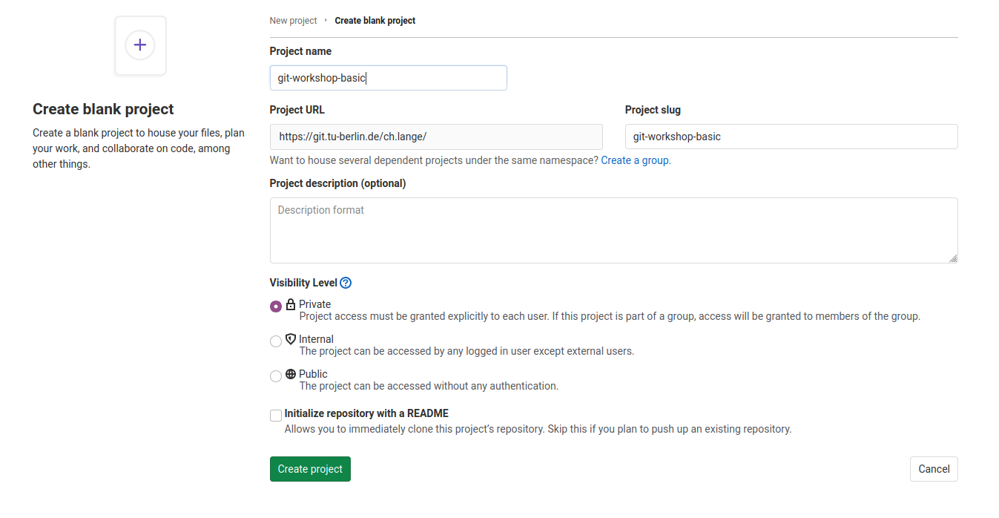

=====
Tasks
=====

.. note::

   Some screenshots in this guide are placeholders pending a refresh of the
   2021-era GitLab UI captures. Where a screenshot is missing, a short prose
   description of what you should see/do is given instead.

This page contains all tasks that will help you to practise what you learned
about Git. To get most out of the workshop please try to solve these tasks and
do not hesitate to ask the instructor for help.

Before starting with the tasks make sure that you did your setup properly (see
the project's ``README.md``).

Task 1: Create a repo
======================

Create Project on GitLab
-------------------------

First of all you want to create a repository on GitLab/GitHub. Therefore, go
to the URL of your GitLab Server, i.e.
`https://git.tu-berlin.de <https://git.tu-berlin.de/>`_. Then you click on
``New Project`` and select ``Create blank project``. Then you may choose a
name for your repository

and click ``Create project``.

Use Project Template
---------------------

Now we created an empty project that we want to fill with an example package
that can do some basic image operations.
Therefore we do the following steps:

1. Open a terminal

2. Install the python package cookiecutter

   .. code-block:: shell

      pip3 install cookiecutter

3. Use ``cd`` to navigate to the directory that you want to start a
   repository.

4. Create your python package with

   .. code-block:: shell

      cookiecutter https://github.com/spirousschuh/cookiecutter-git-workshop-basics

   Now you will see

   .. code-block:: shell

      author_name [Josephine Doe]:

   This requires your input now. You can either press *Enter*, then the
   author_name will be Josephine Doe. Or you can enter your own name.

5. Answer the questions that will be prompted to you or press *Enter* to
   choose the default value. You do not need to reveal your real data, as it
   is a toy project anyway. Cookiecutter will prompt you one question at a
   time on the command line, roughly like this:

   .. code-block:: shell

      author_name [Josephine Doe]: Josephine Doe
      author_email [your@address.eu]: josephine@example.com
      package_name [git_workshop_basic]: my_image_package
      package_description [A lightweight python package to practise some git]:
      package_url [https://git.tu-berlin.de/you/your_repo_name]:

   Pay attention at the third question (``package_name``). The answer to
   that question will be the name of the folder where you can find your
   package later.

6. Make sure that the folder exists by entering the folder.

   .. code-block:: shell

      cd my_image_package

   The name of the folder corresponds to your answer to the question
   ``package_name [git_workshop_basic]:``.

7. Go back to your browser and open
   `https://git.tu-berlin.de <https://git.tu-berlin.de>`_. Then go to the
   project that you just created in the `Create Project on GitLab`_ section.
   As it is an empty project the landing page should look like this:

   .. image:: images/project_setup.png

8. Follow the step that are displayed under ``Git global setup`` (first red
   box) one by one, i.e. you copy each line to your terminal and press
   *Enter*.

9. Follow the steps you find in the section ``Push an existing folder``
   (second red box). You need to replace ``cd existing_folder`` with the
   package name that you chose in step 5. In case you forgot the package
   name you can check it with ``ls -l`` which displays the content of the
   current directory.

10. Go to your project webpage
    ``https://git.tu-berlin.de/your_name/your_project``. When you see a
    basic README.md file you succeeded.

Task 2: Improve the Readme
===========================

Now we will get to know our package a bit better and try to write down what
we find.

1. Go to the package root folder which contains the README.md.

   .. code-block:: shell

      cd /path/to/your_package

2. Install your package in editable mode (your changes are recognized)

   .. code-block:: shell

      pip install -e .

3. Finally we are done with doing dark magic on the command line. So please
   start PyCharm and open ``your_project``.

4. Use the basic git workflow described on the :ref:`git-workflow` page to
   edit the README.md.

5. Once you are done, follow the workflow all the way and merge the feature
   branch into main.

Task 3: Create a Thumbnail
============================

1. Try to use the functionality already implemented in the package

   .. code-block:: shell

      image_magic --help

2. Try to create a thumbnail with a picture of your choice.

   .. code-block:: shell

      image_magic thumbnail --input-path=sample_picture.jpg --output-path=/some/other/path

3. Use the basic git workflow described on the :ref:`git-workflow` page to
   edit the README.md. In the README.md you want to create a description of
   how to create a thumbnail over command line.

4. Once you are done, follow the workflow all the way and merge the feature
   branch into main.

Task 4: Change thumbnail size
================================

Now we will do the first code change. From now on you should always use the
git workflow described on the :ref:`git-workflow` page.

1. Try to find the code that creates the thumbnail.
2. Change the code so that the size of the thumbnail is different to
   128 x 128 pixels.
3. Test that your code change works.
4. Merge your feature branch.

Task 5: Change direction of rotation
=======================================

1. Find the code that rotates the image.
2. Document that functionality in the README.md.
3. Make a separate commit for the documentation.
4. Now you should change the direction of rotation. Currently the direction
   is counter-clockwise, it should be clockwise.
5. Merge your feature branch.

Task 6 (optional): Color to Black and White
==============================================

This task is more complex. You might want to do some internet research.

1. Add a new subcommand to the command line interface.

   .. code-block:: shell

      image-magic color_to_bw --input-path=/path/color.jpg --output-path=/path/bw.jpg

2. Document this feature in a separate commit.
3. Merge your feature branch.
